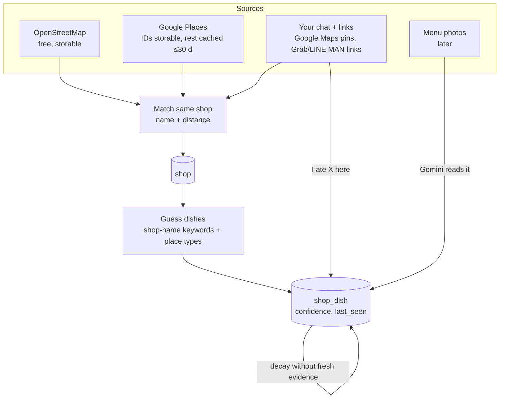

# Design: data gathering

How the bot learns which food exists, where, and what you eat. Decisions as of 2026-11-05; sources inline. Verdicts: **Use now** · **Later** · **Avoid**.

## The four kinds of data

| Data | Question it answers | Where it comes from | Status in prototype |
|---|---|---|---|
| Dish catalogue | What can I eat? What is it like? | Hand-curated `data/dishes.json` (64 dishes) | Done |
| Shops | Where is food, is it open? | OpenStreetMap, Google Places, your links | Importers built |
| Shop → dish map | Who sells *this dish*, at what price? | Shop-name rules, your logs, later menu photos | Name rules + logs done |
| Your behaviour | What do I like, what did I eat? | Accepts, rejects with reasons, meal logs | Done |

The **shop → dish map** (`shop_dish`) is the hard one and the valuable one. No API offers it: Google Places has no menus at all ([data fields](https://developers.google.com/maps/documentation/places/web-service/data-fields)).

## 1. Shop sources

| Option | Good | Bad | Verdict |
|---|---|---|---|
| **OpenStreetMap** (Overpass) | Free, storable (ODbL). Bangkok has 4,805 restaurants, 2,254 cafés, 656 fast food, 145 food courts, 1,173 branded 7-Elevens (counted 2026-11-04) | Thin attributes: only 19% have opening hours, 19% a Thai name, 3% a check date. Public servers are often down (all mirrors failed during our test) | **Use now** as the stored baseline |
| **Google Places (New)** | Best coverage, live `businessStatus` and opening hours | Only place IDs may be stored indefinitely ([policies](https://developers.google.com/maps/documentation/places/web-service/policies)); paid beyond free caps; no menus | **Use now** for your areas and live checks |
| **Overture Places** | ~88M places, permissive licence, monthly releases, `confidence` and `operating_status` ([docs](https://docs.overturemaps.org/guides/places/)) | Needs a batch job (DuckDB over Parquet) | **Later**: Bangkok-wide baseline job in Python |
| **Foursquare OS Places** | Apache-2.0, has `date_closed` | Gated access | **Later**, if Overture has gaps |
| **Wongnai / LINE MAN** | Richest menus and prices | Terms ban collecting their data | **Avoid** (licence only) |
| **Scraping TikTok / Facebook** | Where Thais discover food | Against terms; oEmbed no longer returns captions | **Avoid**; use shared links + screenshots |

**How the Google sweep works** (`apps/api/src/sources/places.ts`). Nearby Search returns at most 20 places with no paging ([docs](https://developers.google.com/maps/documentation/places/web-service/nearby-search)), so a cell that returns 20 is split into four smaller circles (a quadtree), down to 150 m, with a call cap. The field mask stays at the **Pro** tier (name, location, types, status), because a request is billed at the most expensive field it asks for. Opening hours are **Enterprise** fields, so they're fetched only for the headline you're about to see, and cached for 30 minutes.

Google added useful food types on 2026-02-12: `noodle_shop`, `soup_restaurant`, `hot_pot_restaurant`, `chicken_restaurant`, `halal_restaurant` and others ([place types](https://developers.google.com/maps/documentation/places/web-service/place-types)). `data/shop-keywords.json` maps them to dishes.

## 2. Matching the same shop across sources

| Option | Good | Bad | Verdict |
|---|---|---|---|
| Name similarity + distance gate | Simple, explainable | Thai/English transliteration, chains | **Use now** |
| ML classifier on pairs | Grab reached ≥93% accuracy on labelled pairs ([Gao & Widdows 2020](https://scitepress.org/Papers/2020/94166)), but **excluded Thailand** for script reasons | Needs labelled pairs | **Later**, after ~200 hand-labelled pairs |

Rules in `sources/shops.ts`: same source ID first; otherwise same normalised name (≥ 0.85 similarity, after stripping "ร้าน", spaces and punctuation) within 60 m; chains (7-Eleven, Café Amazon) only within 30 m. Next steps: compare Thai with Thai and English with English, bridge scripts with royin romanisation and Thai soundex (PyThaiNLP), and treat a matching +66 phone number within 200 m as near-certain.

## 3. Which dishes a shop sells

| Option | Good | Bad | Verdict |
|---|---|---|---|
| **Shop-name keywords** ("ข้าวมันไก่…" → ข้าวมันไก่) + place types | Free, instant | Generic names ("ครัวป้าแดง") give nothing | **Use now** (confidence 0.3–0.95) |
| **Your logs** ("ate X at Y") | Ground truth | Only places you've been | **Use now** (confidence 0.95) |
| **Menu photos → Gemini** | Prices and full menus | Small print and handwriting fail: Gemini 2.5 Pro scored 0.90 on full-page Thai OCR but 0.50 on fine text ([ThaiOCRBench](https://arxiv.org/html/2511.04479v1)) | **Later**; confirm each extraction |
| **Gemini + Search grounding** per shop | Fills gaps on demand | Costs per query after 5,000 free/month | **Later**, for the headline only |

Menu extraction plan (later): pass 1 transcribes `{raw_text, price, size_variants, bbox}`; pass 2 maps each item to the catalogue by offering the top-k fuzzy matches as an `enum`, so the model can't invent dishes. Normalise with PyThaiNLP (zero-width characters, Thai digits ๕๐ → 50) and match with rapidfuzz `partial_ratio`.

## 4. The dish catalogue

| Option | Good | Bad | Verdict |
|---|---|---|---|
| **Hand-curated, seeded from Wikipedia's list** (~330 dishes) | Small enough to own; attributes you trust | Manual work; CC BY-SA if you copy text | **Use now** (64 dishes; grow toward 150–250) |
| Wikidata | CC0 IDs and labels | Only 76 Thai dishes, 39 with Thai labels | Use for IDs only |
| pythainlp/thai_food (159 recipes, CC0) | Ingredients for calorie templates | Recipes, not menus | **Later** for nutrition |

Model variants as **family + facets** instead of every combination: ก๋วยเตี๋ยว = noodle {เส้นเล็ก, เส้นใหญ่, หมี่, บะหมี่, วุ้นเส้น, เกาเหลา} × broth {น้ำใส, น้ำตก, ต้มยำ, เย็นตาโฟ, แห้ง}. Keep spelling variants as aliases. กะเพรา is the correct spelling, but people type กระเพรา, so both must match.

## 5. Freshness: not recommending closed shops

The top trust-killer is sending you to a closed shop. LINE MAN Wongnai sees about 3,000 closures a quarter.

| Signal | Use |
|---|---|
| Google `businessStatus` (OPERATIONAL / CLOSED_TEMPORARILY / CLOSED_PERMANENTLY) | Checked when importing; closed shops are never suggested |
| Google `currentOpeningHours.openNow` | Headline only, cached 30 min |
| Place ID returns NOT_FOUND | Mark obsolete (refresh IDs older than 12 months) |
| Your "ร้านปิดแล้ว?" button | Immediate; later needs two agreeing reports once friends join |
| `shop_dish.last_seen` + decaying confidence | Half-life *guess*: 90 days for stalls, 365 for restaurants |
| Thai calendar | เทศกาลกินเจ (10–18 Oct 2026) boosts เจ dishes; Songkran and Chinese New Year mean many stalls close |

## 6. Your contributions: one tap, not forms

What works elsewhere: StreetComplete asks one simple question at a time; Google asks "Know this place?" only where it's unsure; Waze shows "Still there / Not there" as you pass ([StreetComplete](https://wiki.openstreetmap.org/wiki/StreetComplete), [Local Guides](https://support.google.com/local-guides/answer/7082158), [Waze](https://support.google.com/waze/answer/12237550)).

So the bot asks only about low-confidence facts, with one-tap answers:

- After a meal: "ได้มาจากไหน?" → 🏪 shop (send the Google Maps pin) · 🛵 app (send the Grab / LINE MAN link) · 🏠 homemade (just log it). *Built.*
- On a card: "ร้านปิดแล้ว?" *Built.*
- Later: "กะเพรายัง 50 บาทไหม? ใช่ / ไม่ใช่". A menu photo is the single most valuable contribution.

## 7. 7-Eleven fallback

There's no public catalogue of ready meals, and the online-shop terms ban copying. **Use now:** a hand-made list (4 generic items so far), with store locations from OSM or Places. **Later:** grow it from your own photos of shelf prices and nutrition labels, read by Gemini.

## Licences and terms in one place

| Source | Rule we follow |
|---|---|
| OpenStreetMap (ODbL) | No obligations while it's just you; once friends use it, add "© OpenStreetMap contributors" in an About reply. Keep OSM-derived tables separable |
| Google Places | Keep only `google_place_id` indefinitely; names and coordinates are a cache (`google_cached_at`), refreshed within 30 days |
| Open-Meteo | Free for non-commercial use |
| Thai FCD (nutrition) | Non-commercial use with credit to INMU |
| Everything we collect | Facts only (shop, dish, price, link). No copied reviews, photos or reviewer names; follow robots.txt; nothing behind a login; no getting around anti-bot protection |
