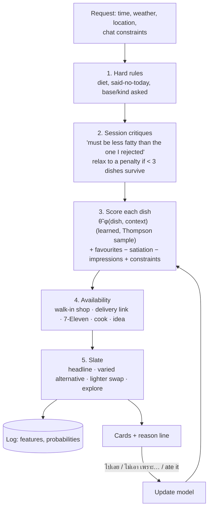

# Design: the recommender

How one answer to "กินอะไรดี?" is made, why each piece is there, and what was rejected. Implemented in `apps/api/src/rank/`. Background: [how food apps do it](../learn/01-how-food-apps-recommend.md) and [methods](../learn/02-recommender-methods.md).

## The cascade

## Decisions, with the options considered

### D1. What produces the score?

| Option | Good | Bad | Verdict |
|---|---|---|---|
| LLM ranks the dishes | Easy to build | Position bias, popularity bias, off-catalogue items, cost per request ([Hou et al.](https://arxiv.org/abs/2305.08845), [He et al.](https://arxiv.org/abs/2308.10053)) | **Avoid** |
| Hand-tuned formula only | Explainable, works on day one (Swiggy's step 2) | Never learns your quirks | A good start, not enough |
| Independent Beta-Bernoulli bandit per dish | Simple | Each dish gets tried about once in hundreds of decisions | **Avoid** as the main model |
| Collaborative filtering | Industry standard | Needs many users | **Avoid** |
| **Linear Thompson sampling over attribute × context features, hand formula as the prior** | Day-one sense from the prior; every meal teaches every similar dish; exploration built in | ~25 weights to sanity-check | **Use now** (`lints-v1`) |

The features (`rank/features.ts`) are the 8 dish attributes, the base (rice/noodle/other), whether the dish fits the meal slot, and context interactions such as `soupy×rain`, `cold_dish×heat`, `heavy×breakfast` and `noodle×late`. The prior μ0 encodes common sense (soup when raining +0.4, heavy at breakfast −0.4) with the strength of 3 observations, so your own behaviour overrides it after a handful of meals.

### D2. What isn't left to the model?

Some things are known rules, not things to learn. They're named terms in `rank/score.ts`, so the reason line can explain them:

| Term | Why it's separate | Value (*guess*, tune from logs) |
|---|---|---|
| Diet | Delivery Hero's similarity model sent meat to vegetarians | Hard filter |
| Said no to this dish today | Don't show the same thing twice | Hard filter, 12 h |
| Session critique | "มันไป" must change the next pick now | Filter, δ = 0.15; relax below 3 dishes |
| Satiation | "เพิ่งกิน" is boredom, not dislike (Kapoor et al.) | −0.9 · Σ exp(−Δt/τ), τ = 72 h dish, 24 h family |
| Favourites | Swiggy's trees "forgot" favourites; a per-dish memory keeps them | ±0.3 from a per-dish Beta |
| Impressions | Shown again and again without being picked → fade (DoorDash) | −0.06 per ignored showing, 7 days |
| Chat constraints | An explicit ask beats an older critique | 1.5 per attribute asked; +2 for a named dish |
| Novelty after "อยากลองใหม่" | Satisfy the explicit ask | +0.6 for never-eaten dishes, 3 h |

### D3. How a dish becomes something you can act on

For the top 20 dishes, `select.ts` finds options: the best walk-in shop within 1.5 km (confidence minus distance), the best shop with a delivery link, a 7-Eleven item, a cook-at-home dish, or "idea" if no shop is known. "ไกลไป" halves the radius for 3 hours and favours delivery. If a Places key is set, the walk-in headline is checked for open-now (Enterprise field, cached).

### D4. What goes on the cards

| Slot | How it's chosen | Why |
|---|---|---|
| **Headline** | Highest score under this request's Thompson draw | Exploration where the model is unsure |
| **Varied alternative** | MMR: score − 0.4 × similarity to what's already chosen, + a bonus for a different kind | No three noodle soups in a row |
| **Lighter swap** | Only after a rich headline: a comparable dish (similarity ≥ 0.45) that is clearly less fatty/heavy and no less clean | Pairing nudges people to the lighter option 62% of the time; filters don't (Elsweiler et al.) |
| **Explore** | Uniform random from the rest | Its probability is exactly 1/pool, which makes future offline evaluation possible |

Rejected: three or more near-identical options (choice overload, low information); a health filter (patronising, and people ignore it).

### D5. How feedback teaches

| Event | Reward to the model | Other effects |
|---|---|---|
| ไปเลย | r = 1, using the φ the card was shown with | Provisional meal log; favourite +1; shop → dish confirmed |
| Taste chip (เค็มไป, มันไป, …) | r = 0 at half weight | Session filter; fading mood penalty |
| Plain ไม่เอา / other | r = 0 | Favourite −1 |
| เพิ่งกิน · ไกลไป · แพงไป · อยากลองใหม่ | none | Satiation / radius / price / novelty |
| Logged meal not from a card | r = 1 with current context | Favourite +1; shop → dish confirmed |
| Onboarding ticks | Pseudo-observations, neutral context | Shapes the prior like real data would |

Using the **logged φ** at accept time avoids train/serve mismatch (the LINE MAN Wongnai lesson).

### D6. Cold start

Onboarding shows 16 dishes chosen by **greedy D-optimal design**: each next dish is the one the model is most uncertain about, given the ones already shown. Tap = like, tap again = dislike; plus diet chips. With no ticks at all, the prior alone gives sensible time- and weather-aware picks.

## Parameters to tune (all are guesses until logs say otherwise)

| Where | Name | Value |
|---|---|---|
| `model.ts` | λ (prior strength), v (exploration width) | 3, 0.35 |
| `score.ts` | critique δ, session length, min eligible | 0.15, 3 h, 3 |
| `score.ts` | satiation β, τ dish / family | 0.9, 72 h / 24 h |
| `score.ts` | favourite, impression, constraint, novelty weights | 0.3, 0.06, 1.5, 0.6 |
| `select.ts` | MMR λ, top dishes, posterior draws | 0.6, 20, 200 |

## Next versions

- **v2:** tune τ and β from "เพิ่งกิน" rejections (direct satiation labels); add `heavy×recent_heavy_meal` and price-band features; Thai holiday calendar prior.
- **v3:** compound critiques mined from the logs ("lighter *and* closer"); friend-level priors (hierarchical, DoorDash-style) when friends join.
- **Never** (at this scale): deep ranking, two-tower retrieval, graph networks.
