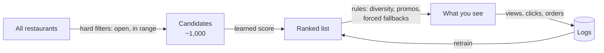

# How food apps recommend (Grab, LINE MAN, DoorDash, Uber Eats, Swiggy, Delivery Hero, Zomato)

Learning notes from the platforms' own engineering write-ups, read 2026-11-05. Each claim links its source. "Unconfirmed" means the source didn't say.

**The one-paragraph version.** Every big platform runs the same shape: *retrieve* a few hundred to a few thousand candidates cheaply, *rank* them with a learned model, then *re-rank* with business rules (diversity, open now, promotions). They differ in which model sits in the middle, and most of them started with something simple: popularity, then a hand-tuned formula, then gradient-boosted trees, then deep models. The deep stuff only pays off with millions of orders. The simple steps are the ones we can copy.

## Grab

Sources: [G1 everyday super app (2019)](https://engineering.grab.com/grab-everyday-super-app) · [G2 multi-armed bandits (2021)](https://engineering.grab.com/multi-armed-bandit-system-recommendation) · [G3 query expansion (2022)](https://engineering.grab.com/query-expansion-based-on-user-behaviour) · [G4 user foundation models (2025)](https://engineering.grab.com/user-foundation-models-for-grab) · [G5 personalising GrabFood (2023)](https://www.grab.com/inside-grab/stories/personalising-food-recommendations-on-grabfood/)

- **Strategies, not one model.** The feed mixes trending, favourites, collaborative filtering, habitual ("lunch browsing") and deep models, chosen by experiment [G1].
- **A bandit picks the ranker.** "Recommended for You" uses batched Thompson sampling to choose between several ranking models, with a Beta distribution per model. The reward is checkouts per widget view, updated every 30 minutes [G2].
- **Signals:** activity across Grab services, time of day, location, store hours, rolling popularity. Views, clicks and orders are weighted differently [G1]. Budget and willingness to wait are learned preferences [G5]. The 2025 foundation model turns clickstreams, menus, prices and distances into user embeddings that other rankers use [G4].
- **Lessons:** old interactions must decay or recommendations stop making sense [G1]. Search used to return closed or out-of-range merchants [G3]. The top ~1,000 search keywords are over 70% of traffic, so they were annotated by hand [G3].

## LINE MAN Wongnai

Sources: [L1 data science at LMWN (2022)](https://www.linkedin.com/pulse/data-science-line-man-wongnai-nawat-win-suvansinpan) · [L2 9× cheaper inference (Jul 2026)](https://life.lmwn.com/how-i-reduced-ml-inferencing-resource-usage-at-scale-by-9x-lmwn-3e7170e0b80d) · [L3 feature platform (Oct 2026)](https://life.lmwn.com/from-feature-chaos-to-unified-ml-delivery-feature-platform-at-line-man-wongnai-6c155d40d067) · [L4 Wongnai data science interview (~2019)](https://blog.datath.com/wongnai-data-science-review/)

- **Filter, then rank.** A search term filters restaurants first; in dense Bangkok areas up to ~1,000–2,000 candidates go to a ranking server [L2].
- **Features** like `order_per_day` and `recency` (days since last order) are served from Redis; there are hundreds [L2][L3]. The model type isn't stated (unconfirmed).
- **Result:** personalised Popular/Trending sections brought almost 30% more revenue than non-personalised ones [L1].
- **Lessons that matter for Thailand:** about 3,000 restaurants close every quarter, and Thai dish names vary in word order (ข้าวหมูสับกะเพรา vs ข้าวกะเพราหมูสับ) [L4]. Train/serve mismatch (features computed differently in training and live) pushed them to build a feature platform [L3].

## DoorDash

Sources: [D1 homepage exploit/explore (2022)](https://careersatdoordash.com/blog/homepage-recommendation-with-exploitation-and-exploration/) · [D2 personalised cuisine filter (2020)](https://careersatdoordash.com/blog/personalized-cuisine-filter/)

- **Three passes:** up to 1,200 candidates from Elasticsearch (with rules that force in popular stores), then ~50 for the first page, then the order of the whole page [D1].
- **Signals:** cuisine, price, popularity, rating; the user's taste, vegan status, affordability; view/click/order history; and context: ETA, distance, fee, promotion, day part, holiday, **weather** [D1].
- **Exploration done carefully:** a deep ranker predicts conversion, then a UCB bonus is added. The bonus *shrinks fast the more often that store has been shown to you*, so a store you keep ignoring fades and an unseen one gets a chance [D1].
- **Cold start:** the cuisine filter uses Thompson sampling with Beta priors *stacked by geography* (district → submarket → world). A new user inherits the prior from the level above [D2].
- **Lesson:** pure exploitation creates filter bubbles and a stale homepage, and hurts new merchants [D1].

## Uber Eats

Sources: [U1 graph learning (2019)](https://www.uber.com/blog/uber-eats-graph-learning/) · [U2 two-tower embeddings (2026)](https://www.uber.com/en-US/blog/innovative-recommendation-applications-using-two-tower-embeddings/)

- **Two-tower retrieval:** an eater tower (recently ordered stores, decayed over months) and a store tower, matched by nearest-neighbour search in ~100 ms. It replaced thousands of per-city models [U2].
- **Graph learning:** GraphSAGE over user–dish and user–restaurant edges, with a loss that counts a dish ordered ten times more than one ordered once [U1].
- **Lesson:** the two-tower project took nearly a year to launch, and AUC/NDCG didn't reflect real quality, so they built session-level recall metrics [U2].

## Swiggy

Sources: [S1 feed ranking evolution (2019)](https://medium.com/swiggy-bytes/evolution-of-and-experiments-with-feed-ranking-at-swiggy-17204769e79f) · [S2 learning to rank restaurants (2021)](https://medium.com/swiggy-bytes/learning-to-rank-restaurants-c6a69ba4b330)

Swiggy's history is the clearest roadmap for us:

1. **Popularity.**
2. **A multiplicative utility:** preference × similarity × popularity, adjusted for weather stress and diversity, with weights from grid search or intuition [S1]. ← *this is roughly where our v1 starts*
3. **Gradient-boosted trees** on customer, restaurant and pair features [S1].
4. **A deep pairwise ranker** (Wide & Deep). The "wide" part was added because trees *forgot individual favourites* [S2].

- **Cold start for new restaurants:** topic vectors from the menu text give an immediate similarity score; established restaurants use only items people actually ordered, to defeat menu stuffing [S1].
- **Lesson:** "no one algorithm wins across all cities" [S1].

## Delivery Hero / foodpanda

Sources: [H1 ranking for new users (2023)](https://deliveryhero.jobs/blog/personalisation-delivery-hero-ranking-restaurants-for-new-users/) · [H2 personalised model (2023)](https://deliveryhero.jobs/blog/dont-worry-we-got-you-personalised-model-2/)

- **New users:** collaborative filtering fails, so a content-based baseline (popularity, plus distance as a proxy for fee and time) with **two weights tuned by replaying past sessions** and measuring NDCG. It beat "sort by distance" [H1].
- **Explicit ratings** come from under ~1% of users; everything else is implicit [H2].
- **Lesson:** a similarity score that ignored vegetarian status recommended meat restaurants to vegetarians [H2]. *Diet must be a hard filter.*

## Zomato

Sources: [Z1 first personalisation (2016)](https://www.zomato.com/blog/our-first-steps-towards-personalisation-on-zomato/) · [Z2 graph recommendations (2022)](https://www.zomato.com/blog/connecting-the-dots-strengthening-recommendations-for-our-customers-part-one/)

- Personalising on cuisine, spend, time of day and bookmarks raised conversion 2.5%; reordering menus made ordering 21% faster [Z1].
- GraphSAGE gave only a slight gain, took ~20 hours per region to train, and was "not practical" across 500 cities [Z2]. Even at scale, fancy isn't automatically better.

## What a one-person app can copy, and what it can't

| Technique | Needs | For us |
|---|---|---|
| Two-tower retrieval, graph neural nets, foundation models, deep LTR | Millions of orders | **Avoid** — not enough data |
| Collaborative filtering / matrix factorisation | Many overlapping users | **Avoid** — 1–20 users is an empty matrix |
| A/B tests with significance, bandits choosing between models | Large traffic | **Avoid** for now |
| Retrieve → score → rules pipeline | Nothing | **Use now** ([design](../design/02-recommender.md)) |
| Swiggy-style hand utility, weights tuned by replaying logs [S1][H1] | A few hundred decisions | **Use now** |
| Beta priors + Thompson sampling, hierarchical priors [D2] | Nothing | **Use now** |
| Impression penalty: shown-but-ignored items fade [D1] | Logged impressions | **Use now** |
| Decayed history; long-term favourites kept separate [G1][S2] | Meal log | **Use now** |
| Diet as a hard filter [H2] | Diet tags | **Use now** |
| Content features for new shops from menu text [S1] | Menus | **Later** (menu photos) |
| Log everything at decision time, with features [L3][D1] | Discipline | **Use now** |
| Popularity-only baseline to compare against [S1] | Nothing | **Use now** |

Our advantage over all of them: explicit reasons. Platforms almost never get "too fatty"; we get it on every rejection.
