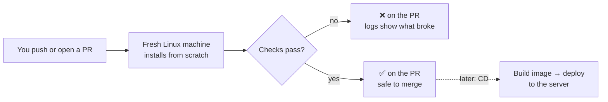

# CI/CD: what it is, and what this repo uses it for

**Short version.** CI (continuous integration) is a robot that checks every change on a clean machine. CD (continuous delivery/deployment) is the same robot shipping the change once the checks pass. CI is useful from the first commit, live app or not. CD only matters once there's somewhere to deploy to. This repo has CI now; CD comes when the LINE bot needs a public server.

## Why bother on a one-person project?

- **"Works on my machine" isn't proof.** Your PC has a running database, old files and Windows paths. CI starts from nothing on Linux, which is closer to where the bot will eventually run. (It already found one bug: the test command's file pattern behaved differently on Linux and Windows.)
- **It checks what you'd forget to check.** A quick edit to the scorer can break a migration or the web build you didn't touch.
- **It makes the PR trustworthy.** The ✅ means typecheck, tests, build and the full suggest → critique → log flow all passed. Claude Code's PR bar reads these checks, and Auto-fix can repair a red one.
- **It's free here.** GitHub Actions is free on standard runners for public repositories. Private repos get a monthly allowance of minutes (check GitHub's current limits).

## Our pipeline (`.github/workflows/ci.yml`)

Runs on every pull request and every push to `main`.

| Job | What it does | Why it's separate |
|---|---|---|
| `checks` (~1 min) | `npm ci` → typecheck → unit tests → production build of the web app | Fast feedback; needs no database |
| `e2e` (~3 min) | Builds our Postgres image (PostGIS + pgvector), migrates, seeds 64 dishes, starts the API, runs `scripts/smoke.ts` | Proves the whole system works together; only runs if `checks` passed |

Small choices in the file, and why:

| Line | Why |
|---|---|
| `permissions: contents: read` | Least privilege: the workflow can read code but not push or change settings |
| `concurrency … cancel-in-progress` | Pushing twice quickly cancels the stale run |
| `npm ci` (not `npm install`) | Installs exactly what `package-lock.json` says, or fails |
| `cache: npm` | Reuses downloads between runs |
| `timeout-minutes` | A hung job can't burn minutes forever |
| `if: failure()` → print `api.log` | You only see server logs when you need them |

No secrets are used: without `GEMINI_API_KEY` and `GOOGLE_PLACES_API_KEY` the API falls back to the rule parser and skips Places, which is exactly what the tests expect.

## GitHub Actions vocabulary

| Word | Meaning |
|---|---|
| Workflow | One YAML file in `.github/workflows/` |
| Trigger (`on:`) | What starts it: a push, a PR, a schedule, a button |
| Job | A group of steps on one fresh machine; jobs run in parallel unless `needs:` orders them |
| Step | One command (`run:`) or a reusable action (`uses:`) |
| Runner | The machine (`ubuntu-latest`), thrown away after the job |
| Action | A packaged step someone published, e.g. `actions/checkout@v7` |
| Status check | The ✅/❌ a job reports back to the PR |
| Secret | An encrypted value (an API key) a workflow can read but logs mask; not given to PRs from forks |

## When a check fails

1. Open the PR → **Checks** tab → the red job → the red step. The log shows the exact command and error.
2. Reproduce locally with the same command (`npm run typecheck`, `npm test`, `npm run build -w apps/web`, or `npm run setup` + `npm run smoke -w apps/api`).
3. Fix, push, and CI reruns by itself. Or turn on **Auto-fix** in the Claude Code PR bar and let it try.

## Options considered

| Option | Good | Bad | Verdict |
|---|---|---|---|
| **GitHub Actions** | Built into GitHub, free for public repos, the PR bar reads it | YAML has a learning curve | **Use now** |
| GitLab CI | You already know it from paulxlab | The repo is on GitHub; mirroring adds moving parts | Avoid here |
| CircleCI / others | Fine products | Another account and another place to look | Avoid |
| No CI, test by hand | Zero setup | Easy to skip; Linux-only bugs slip through | Avoid |

## Optional: require green checks before merging

GitHub can block merging until `checks` and `e2e` pass: repo **Settings → Rules → Rulesets → New branch ruleset** for `main`, then **Require status checks to pass**. It's a repository setting, so it's yours to turn on. For a solo project it's a safety net, not a must. It pairs well with auto-merge ("merge when green").

## Later: CD, once the LINE bot goes live

LINE delivers messages by calling a public HTTPS webhook, so the API will need a server that's always reachable. Then a third job deploys on every push to `main`:

| Option | Good | Bad | Verdict (for later) |
|---|---|---|---|
| Container platform (e.g. Cloud Run, Fly.io, Render) + managed Postgres | Deploy = build image and push; HTTPS included; little to maintain | Another bill to watch; Postgres extensions must be supported | Likely pick; compare against the ≤ ฿1,000/month budget then |
| Small VPS with Docker Compose, deployed over SSH | Fixed cost; same `docker-compose.yml` as today | You patch and back it up yourself | Good if budget is tight |
| Static hosting (GitHub Pages) | Free | Only the web UI, not the API or database | Only for a public demo of the UI |

CD adds things CI doesn't need: deploy secrets (stored as GitHub secrets), database migrations run on deploy, and a way to roll back. None of it is needed while the app runs on your PC.
